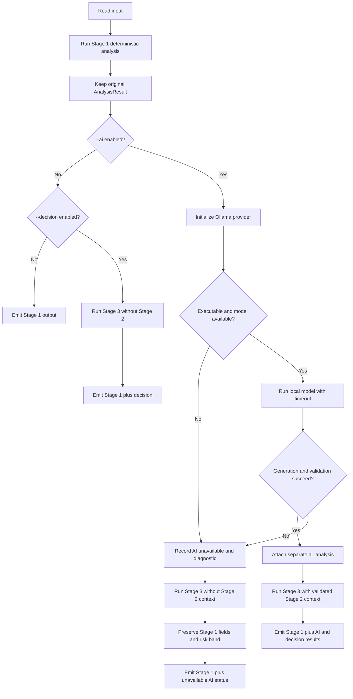

# ScamSentry Architecture

## Goals and boundaries

ScamSentry is a CLI-first defensive triage tool. It keeps directly observable
signals separate from inferred intent and uses no network lookup to inspect a
message or its URLs.

- **Stage 1** validates and normalizes input for matching, extracts deterministic
  findings, inspects URL syntax locally, and computes the existing heuristic
  risk band.
- **Stage 2** is opt-in and asks a local model to interpret context, explain
  supplied findings, describe uncertainty, consider alternatives, and suggest
  safe next steps.
- Stage 2 is advisory. It never edits the `AnalysisResult`, finding list,
  analysis status, evidence, or risk band.
- **Stage 3** validates Stage 1 and optional Stage 2 outputs, recomputes a
  versioned final risk band from Stage 1 evidence, and attaches deterministic,
  evidence-linked recommendations.
- Stage 3 runs with `--decision` or automatically alongside `--ai`; Stage 2
  cannot create evidence or alter the final Stage 3 band.
- Python runtime dependencies remain empty. Ollama is an optional separately
  installed local program.

## Component diagram

```mermaid
flowchart LR
    User[User input] --> CLI[CLI]
    CLI --> S1[Stage 1 analyzer]
    S1 --> Result[AnalysisResult]
    Result --> S1Output[Stage 1 output]
    Result -->|only when --ai is set| Orchestrator[AI orchestrator]
    Message[Original message] --> Orchestrator
    Result --> Context[Explicit Stage 1 context conversion]
    Context --> Prompt[Prompt builder]
    Orchestrator --> Prompt
    Prompt --> Provider[AIProvider protocol]
    Provider --> Ollama[OllamaProvider]
    Ollama --> InstalledCheck[ollama list; verify model exists]
    InstalledCheck --> OllamaRun[ollama run --format json --nowordwrap MODEL via stdin]
    OllamaRun --> Raw[Untrusted model text]
    Raw --> Validator[JSON and schema validator]
    Validator --> AIResult[Typed AIAnalysis]
    Result --> Decision[Stage 3 validator and fusion]
    AIResult --> Decision
    Decision --> DecisionResult[Typed DecisionResult]
    AIResult --> Combined[Stage 1 JSON plus ai_analysis]
    DecisionResult --> Combined
    S1Output --> Combined
```

## Data flow

1. `scamsentry.cli.run` parses one input source (`--text` or `--file`) and
   invokes the unchanged Stage 1 `analyse_message` or `analyse_file`.
2. Stage 1 returns a typed `AnalysisResult`; its `to_dict()` is the existing
   JSON-compatible Stage 1 schema.
3. If neither `--ai` nor `--decision` was passed, the CLI emits the Stage 1
   result exactly as before and does not instantiate an AI provider.
4. If AI is enabled, `build_prompt` converts only the original message and
   selected Stage 1 fields (finding IDs, titles, explanations, evidence,
   categories, severity, risk band, and incomplete checks) into explicit JSON.
   The prompt labels this JSON as untrusted content and provides separate
   trusted analysis instructions.
5. `AIProvider` abstracts text generation. The initial implementation is
   `OllamaProvider`, which locates the executable with `shutil.which`, checks
   `ollama list` for the selected model, and calls
   `ollama run --format json --nowordwrap MODEL` with UTF-8 prompt text on
   stdin. JSON formatting requests machine-readable output; `--nowordwrap`
   avoids terminal reflow control sequences. It does not run `ollama pull`.
6. Model output is untrusted until parsed and validated. `parse_ai_response`
   rejects invalid JSON, extra or missing keys, invalid taxonomy values,
   excessive output, invalid or duplicate finding references, and malformed
   bounded collections.
7. The resulting `AIAnalysis` adds local metadata (model identifier, schema
   version, and advisory disclaimer) to validated model fields. The CLI adds
   this object under the separate `ai_analysis` key; it does not edit or
   regenerate any Stage 1 values.
8. With `--decision` or `--ai`, Stage 3 validates Stage 1 and any successful
   Stage 2 envelope, derives a deterministic final band and fixed defensive
   recommendations, and adds a separate `decision` object. Unavailable or
   invalid Stage 2 is noted and excluded.

## Normal and failure paths

On AI failure, the CLI writes a warning to stderr, returns the successful Stage
1 result, and, in JSON mode, reports `ai_analysis.status: "unavailable"` with a
stable error code. The process retains the existing Stage 1 success exit code
when only optional AI fails. Invalid input and CLI usage errors retain their
existing non-zero exit codes.

## Modules

| Module | Responsibility |
| --- | --- |
| `scamsentry.analyzer` | Deterministic Stage 1, including finding IDs and risk band |
| `scamsentry.models` | Stage 1 typed result and evidence schema |
| `scamsentry.cli` | Existing CLI plus opt-in integration and rendering |
| `scamsentry.ai.provider` | Provider protocol and categorized AI errors |
| `scamsentry.ai.ollama_provider` | Safe local Ollama CLI calls and timeout handling |
| `scamsentry.ai.prompts` | Explicit trusted instructions and JSON-serialized untrusted input |
| `scamsentry.ai.schemas` | Controlled labels, typed Stage 2 result, strict validation |
| `scamsentry.ai.analysis` | Provider-independent orchestration |
| `scamsentry.decision.validation` | Stage 1 and Stage 2 envelope validation |
| `scamsentry.decision.policy` | Versioned deterministic band, signal, and recommendation rules |
| `scamsentry.decision.models` | Typed Stage 3 result, signals, and recommendations |
| `scamsentry.decision.fusion` | Stage 3 public assessment API |

## Trust boundaries and operational decisions

- The analyzed message, findings, and model output are untrusted.
- Input is serialized as JSON rather than interpolated into trusted instructions.
  This reduces ambiguity but does not solve prompt injection.
- The subprocess uses an argument list, `shell=False`, captured UTF-8 streams,
  and a finite timeout. Prompt content is supplied on stdin, not in the command
  line.
- Model output is bounded to 32 KiB before JSON parsing. String and collection
  limits are implemented in `scamsentry.ai.schemas`.
- Diagnostics derived from child-process stderr are bounded and retained only
  on the exception; user-facing messages do not echo raw stderr or message text.
- No message URL is fetched, visited, or executed, and model output is never
  interpreted as a command.
- Ollama is a local process and may have its own resource use or logging policy.

## Adding a provider

Implement `AIProvider` with a human-readable `model_id` and
`generate(prompt, timeout=...) -> str`. Raise `AIAnalysisError` with an
appropriate `AIErrorCode` for expected provider failures. The orchestrator and
schema validator are provider-independent; no Stage 1 changes are required.
Add deterministic unit tests for invocation, timeouts, and failure behavior
before exposing a new provider in the CLI.

## Compatibility

The Stage 1 JSON structure and `AnalysisResult` interface remain unchanged when
neither optional stage is requested. With `--ai`, `ai_analysis` and `decision`
are additional top-level fields; `--decision` adds only `decision`. AI schema
version `1.0` describes the validated `AIAnalysis` envelope; the Stage 3
decision schema and policy are separately versioned. Unknown Stage 2 fields are
rejected so incompatible model output fails closed.
